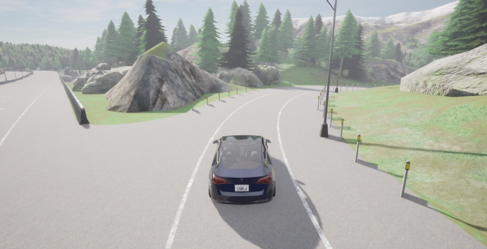
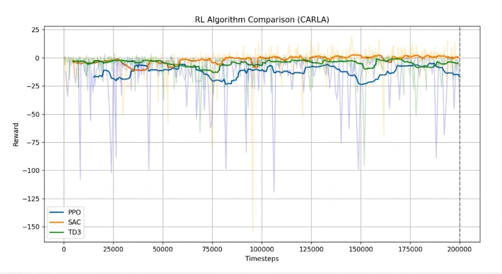
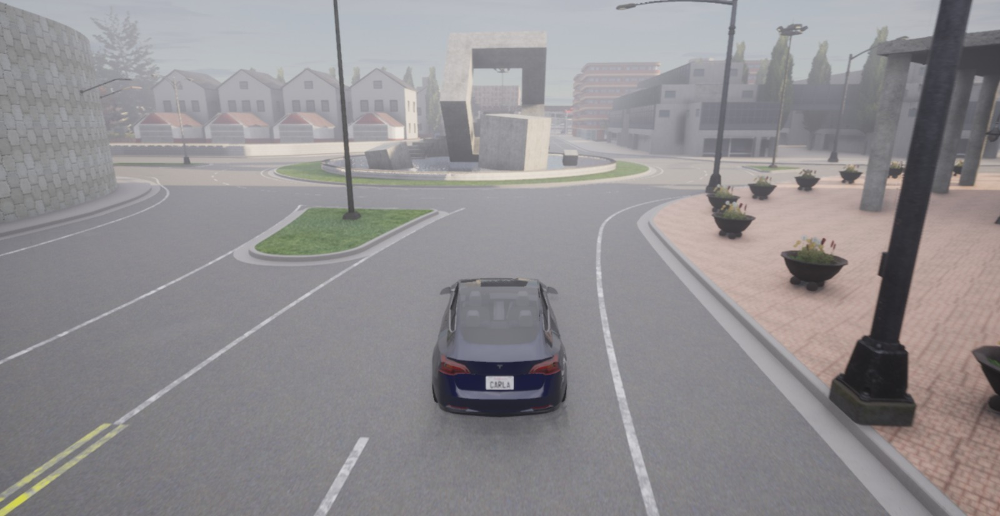
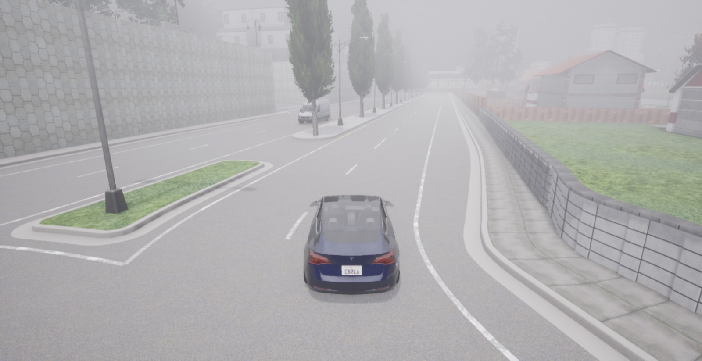
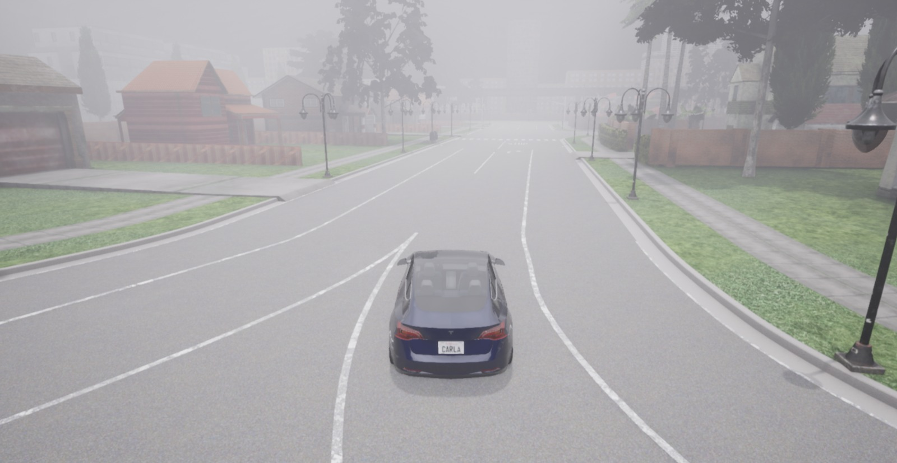
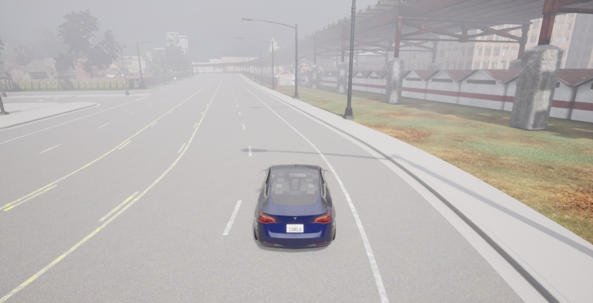
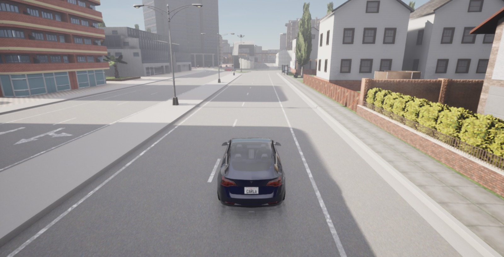
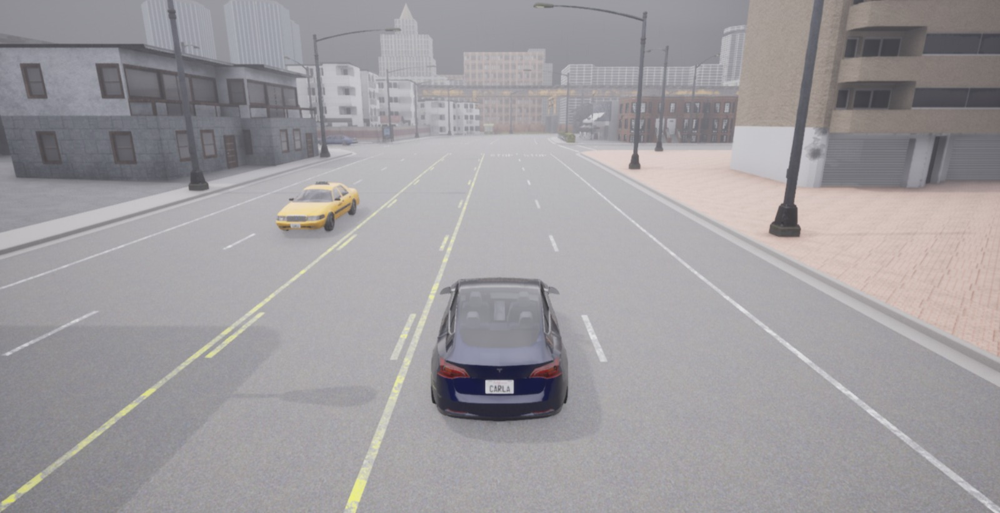
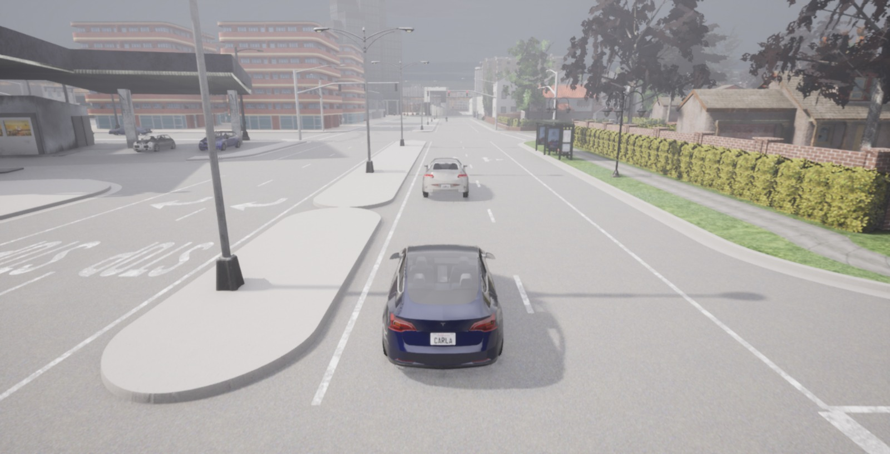

# Autonomous Driving with Deep Reinforcement Learning in CARLA

This capstone project investigates end-to-end autonomous driving using deep reinforcement learning. An agent is trained to drive from front-camera images alone in the [CARLA](https://carla.org/) simulator, using a custom [Gymnasium](https://gymnasium.farama.org/) environment and the [Stable-Baselines3](https://stable-baselines3.readthedocs.io/) library. Three algorithms, Proximal Policy Optimization (PPO), Twin Delayed DDPG (TD3) and Soft Actor-Critic (SAC), were implemented and evaluated. SAC achieved the best performance and was selected as the final model.



## Key Features

- A custom Gymnasium environment (`CarlaEnv`) built on CARLA in synchronous mode with a fixed time step of 0.05 s
- Vision-based observations consisting of 84×84 grayscale front-camera images
- Continuous control of steering ([-0.5, 0.5]) and throttle ([0, 0.5])
- Domain randomization through multiple training towns, randomized weather, random spawn and destination points, and 20 autopilot-controlled vehicles
- A shaped reward function that rewards speed, progress towards the destination and lane keeping, and penalizes collisions, lane invasions, red-light violations and standing still
- Resumable training scripts for PPO, TD3 and SAC, together with tools for plotting and comparing learning curves

## Repository Structure

```
.
├── src/
│   ├── carla_env.py            # Gymnasium environment (main component)
│   ├── train_all.py            # Train PPO, TD3 and SAC back to back
│   ├── train_sac.py            # SAC training (resumable, tuned hyperparameters)
│   ├── train_td3.py            # TD3 training (resumable, action noise)
│   ├── evaluate_sac.py         # Run a trained SAC model in the simulator
│   ├── plot_results.py         # Plot smoothed reward curves
│   └── compare_algorithms.py   # Save a PPO vs TD3 vs SAC comparison figure
├── examples/
│   ├── check_setup.py          # Verify CARLA connection, sensors, spawning
│   ├── random_policy_demo.py   # Random-action loop with image preprocessing
│   └── ppo_prototype.py        # Early single-file PPO prototype (kept for reference)
├── docs/                       # Put figures / demo GIFs here
├── requirements.txt
├── LICENSE
└── README.md
```

## Requirements

- A machine that can run CARLA (a dedicated NVIDIA GPU is strongly recommended)
- **Python 3.9**
- **CARLA 0.9.x** server. The environment uses the optimized maps (`Town01_Opt` etc.), so use a recent 0.9.x release that includes them
- The CARLA Python API matching your server version
- An NVIDIA GPU with CUDA for training (the scripts use `device="cuda"`; change it to `"cpu"` if you have no GPU, though training will be slow)

## Installation

1. **Install CARLA** from the [official releases](https://github.com/carla-simulator/carla/releases) and extract it.
2. **Create a virtual environment**:
   ```bash
   python3.9 -m venv .venv
   source .venv/bin/activate        # Windows: .venv\Scripts\activate
   ```
3. **Install PyTorch** for your CUDA version from [pytorch.org](https://pytorch.org/get-started/locally/).
4. **Install the remaining dependencies**:
   ```bash
   pip install -r requirements.txt
   ```
   If `pip install carla` does not match your server, install the wheel bundled with CARLA instead (`PythonAPI/carla/dist/`).

## Running the Project

Always **start the CARLA server first** (it listens on `localhost:2000`), then run scripts from the repository root.

```bash
# Linux
./CarlaUE4.sh -quality-level=Low
# Windows
CarlaUE4.exe -quality-level=Low
```

**1. Verify your setup**
```bash
python examples/check_setup.py
```

**2. Train**
```bash
python src/train_sac.py        # SAC
python src/train_td3.py        # TD3
python src/train_all.py        # PPO, TD3 and SAC one after another
```
Training can be interrupted with `Ctrl+C`: the model is saved, and running the script again resumes from the saved checkpoint. Logs go to `logs_<algo>/` and TensorBoard data to `*_tensorboard*/`:
```bash
tensorboard --logdir .
```

**3. Evaluate a trained model**
```bash
python src/evaluate_sac.py
```
This loads `sac_carla_model1.zip`, which is the file written by `src/train_sac.py`.

**4. Plot results**
```bash
python src/plot_results.py            # show reward curves
python src/compare_algorithms.py      # also saves RL_CARLA_Comparison.png
```
These expect `logs_ppo/`, `logs_td3/` and `logs_sac/` (each with a `monitor.csv`) in the working directory.

## Methodology

**Observation:** 84x84x1 grayscale image from a front-mounted RGB camera.

**Action:** `[steer, throttle]`, continuous, steer in [-0.5, 0.5] and throttle in [0, 0.5].

**Reward** (per step), as implemented in `CarlaEnv._compute_reward`:

| Term | Effect |
|---|---|
| Forward speed | positive, 0.1 x speed |
| Progress toward destination | positive, 0.1 x change in distance |
| Reaching the destination | +20 |
| Yaw rate | negative, 0.2 x \|yaw rate\| |
| Distance from lane center | negative, 1.0 x distance |
| Near-zero speed | -10 |
| Collision | -10 |
| Lane invasion | -5 |

**Episode ends** on collision, running a red light, leaving the driving lanes, reaching the destination, or after 1000 steps.

### Algorithm Settings

| Algorithm | Learning rate | Batch size | Notes |
|---|---|---|---|
| PPO | 1e-5 | 64 | `n_steps=1024`, clip 0.2 (`train_all.py`) |
| TD3 | 1e-4 | 256 | buffer 100k, Gaussian action noise 0.1 (`train_td3.py`) |
| SAC | 3e-4 | 1024 | buffer 80k, auto entropy coefficient (`train_sac.py`) |

The comparison used 200,000 timesteps for all three algorithms. The default step counts in the training scripts differ; to reproduce the comparison, set `TOTAL_TIMESTEPS` in `train_all.py` and `total_timesteps` in `train_td3.py` and `train_sac.py` to 200,000. The final SAC model was obtained by continuing training from saved checkpoints: `train_sac.py` loads `sac_carla_model1.zip` when it exists and trains for a further `total_timesteps` steps, so successive runs accumulate.

## Results

### Algorithm Comparison

To select the final algorithm, PPO, TD3 and SAC were trained in the same environment, under identical conditions and for the same number of timesteps (200,000). Their episode rewards were then compared, as shown in the figure below. The dashed vertical line marks the end of the comparison run.



SAC achieved the highest smoothed reward, remaining close to zero and slightly positive for much of the run. TD3 remained slightly negative, while PPO remained substantially lower and showed frequent large reward drops. SAC was therefore selected as the final algorithm and was subsequently trained further, to approximately 1.5 million timesteps in total, to produce the final model. Accordingly, `src/train_sac.py` and `src/evaluate_sac.py` constitute the main pipeline.

### Qualitative Results

The figures below show the trained agent driving in the simulator across different environments, weather conditions (clear, overcast and fog) and traffic situations.

<table>
<tr><td></td><td></td></tr>
<tr><td></td><td></td></tr>
<tr><td></td><td></td></tr>
<tr><td></td><td></td></tr>
</table>

## Acknowledgements

- [CARLA Simulator](https://carla.org/)
- [Stable-Baselines3](https://github.com/DLR-RM/stable-baselines3)
- [Gymnasium](https://gymnasium.farama.org/)

## License

Released under the [MIT License](LICENSE).
